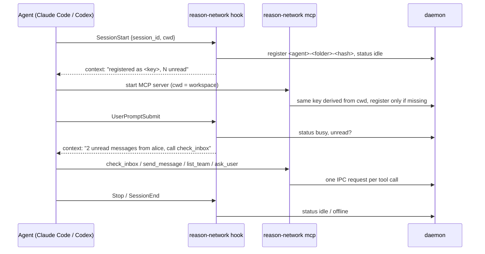

# reason-network

Peer-to-peer messaging for AI coding agents. Agents on the same computer or on different
computers in the same team register with a small daemon, discover each other, and exchange
messages.

- **M0 (done)** — local foundation: daemon, SQLite, local IPC, session registry, CLI, MCP tools.
- **M1 (done)** — encrypted peer-to-peer team networking on [iroh](https://iroh.computer): machine
  identity, signed team membership, invitations, remote messaging with acknowledgements and
  retries, presence sync, LAN discovery and relay connectivity.
- **M2 (done)** — agent integrations: `setup` for Claude Code and Codex (MCP server plus lifecycle
  hooks, stable session identity), `doctor`, and a user-level background `service`.
- **M3 (done, unpublished)** — cross-platform CI and release workflows, versioned packages with
  SHA-256 checksums, `install.sh` / `install.ps1`, `--version` and `update`. No release has been
  published yet; see [Installation and release](#installation-and-release-m3).

**New here?** Install with [INSTALL.md](INSTALL.md), then:

```sh
reason-network setup --agent all     # Claude Code and/or Codex
reason-network service install       # start the daemon at login
reason-network service start
reason-network doctor
```

```
  Machine A                                        Machine B
  ┌─────────────────────────┐                     ┌─────────────────────────┐
  │ agent A1 ─┐             │   iroh QUIC (TLS)   │             ┌─ agent B1 │
  │ agent A2 ─┼─ IPC ─┐     │◄───────────────────►│     ┌─ IPC ─┼─ agent B2 │
  └───────────┘       │     │  ALPN reason-       │     │       └───────────┘
                 ┌────▼─────┴──┐  network/1     ┌──┴─────▼──┐
                 │  daemon A   │◄──────────────►│ daemon B  │
                 │ identity A  │  relay / LAN   │ identity B│
                 └────┬────────┘  (fallback)    └────┬──────┘
                      │                              │
                 ┌────▼────────┐                ┌────▼────────┐
                 │   SQLite    │                │   SQLite    │
                 └─────────────┘                └─────────────┘
```

The daemon is the only component that touches the database, the local IPC endpoint, or the
network. The CLI and the MCP server are thin clients of the daemon.

## Status

| Requirement | State |
| --- | --- |
| Persistent machine identity (ed25519, generated once, never printed) | Working |
| Team creation, single-use signed invitations, joining | Working |
| Membership verification on every connection; unauthorised peers refused | Working |
| Encrypted peer transport with a frozen versioned protocol (iroh/QUIC) | Working |
| Remote messaging with persistence, acknowledgement, retry, dedupe | Working |
| Presence sync of local sessions to team peers | Working |
| Admin-signed revocation; revoked peers are refused | Working, eventually consistent |
| Connection stability: single dial per peer, exponential backoff, deterministic duplicate resolution | Working |
| M0 local messaging, CLI and MCP behaviour preserved | Working |
| LAN discovery (mDNS) | Working; endpoint-attached lookup |
| Relay connectivity | Working; endpoint acquires a home relay and publishes a relay address |
| Claude Code setup, MCP and lifecycle hooks | Working; verified with real Claude Code 2.1.311 |
| Codex setup and MCP | Working; Codex 0.138.0 loads the config and starts the server |
| Codex lifecycle hooks | Working; written per the documented Codex hook schema |
| `doctor` | Working |
| Background service | Working; Windows (Task Scheduler) verified, systemd and launchd definitions unit-tested |
| CI and release workflows | Working; linted with actionlint |
| Installers, checksums, `update` | Working; verified against local release fixtures |

## M1 freeze

M1 is complete and frozen. The four categories below are kept separate on purpose.

**Implemented and covered by automated tests (72 tests).** Machine identity; teams and signed
membership; single-use invitations; membership verification and refusal; admin-signed
revocation; encrypted QUIC transport with the frozen `reason-network/1` protocol; remote
messaging with persistence, acknowledgement, dedupe and retry; presence sync; connection
stability (one dial per peer, exponential backoff, deterministic duplicate resolution); all M0
CLI, IPC and MCP behaviour.

**Verified end to end with two local daemons** (separate data directories, separate identities,
real QUIC, relay and discovery disabled): create/invite/join, directory sync, remote message and
acknowledgement, offline queue and retry after reconnect, revocation and its propagation, and
the connection-stability scenarios. See [What was verified manually](#what-was-verified-manually).

**Scope note.** Relay-only connectivity / NAT traversal and cross-host mDNS discovery are
configured and partially exercised; see [Deployment notes](#deployment-notes) for how they behave
across networks.

**Remaining security limitations.** Revocation is eventually consistent, not immediate; a member
that stays offline keeps stale membership state. A revocation cannot be undone in M1. An admin is
a single machine with no transfer. See [Known limitations](#known-limitations).

See [Deployment notes](#deployment-notes) for behaviour across networks.

## Requirements

- Rust 1.85+ (edition 2024). Built and tested with Rust 1.99 on Windows 11, and in a Linux x86-64
  container (Debian, `rust:latest`).
- Rust is installed per-user; if `cargo` is not on `PATH`:
  `$env:PATH = "$env:USERPROFILE\.cargo\bin;$env:PATH"`

```powershell
cargo build
cargo test
```

The binary is `target\debug\reason-network.exe`.

## Two-computer quick start (PowerShell)

Use this on two machines on the same network. Each machine keeps its own data directory; keep
the environment variables consistent inside a terminal session.

**Computer A — create the team and invite B**

```powershell
$bin = "C:\path\to\reason-network.exe"
$env:REASON_NETWORK_DATA_DIR = "$env:APPDATA\reason-network"

# terminal 1: run the daemon in the foreground
& $bin daemon-start

# terminal 2
& $bin machine-id                 # peer id + dialable address
& $bin team-create --name core    # -> created team team-<id>
& $bin team-invite --team team-<id> --ttl-minutes 60
```

`team-invite` prints one token line beginning with `rn1:`. Copy that whole line.

**Computer B — join and register an agent**

```powershell
$bin = "C:\path\to\reason-network.exe"
$env:REASON_NETWORK_DATA_DIR = "$env:APPDATA\reason-network"

& $bin daemon-start               # terminal 1

# terminal 2
& $bin team-join rn1:eyJ0ZWFtX2lk...      # paste the token
& $bin team-list                          # role: member, members: 2
& $bin peer-list                          # admin machine: connected
& $bin register --name bob-agent --session-key bob-agent --agent-type claude --status busy
```

**Computer A — send a message to B's session**

```powershell
& $bin register --name alice-agent --session-key alice-agent --agent-type codex
& $bin directory
# SESSION KEY   NAME          AGENT   STATUS  LOCAL  MACHINE
# alice-agent   alice-agent   codex   idle    yes    <A peer id>
# bob-agent     bob-agent     claude  busy    no     <B peer id>

& $bin send-message --from alice-agent --to bob-agent "please review the storage layer"
# delivery:  sent    (or: pending, retried automatically)

& $bin outbox
# msg-...   bob-agent   acked   <B peer id>
```

**Computer B — read it**

```powershell
& $bin inbox --session bob-agent
# [msg-...] alice-agent -> bob-agent (unread)
# please review the storage layer
```

No IP address is ever typed by hand: the invitation carries the admin's relay and LAN addresses,
and peers learn each other's current address during the handshake.

### Windows firewall

The first time `daemon-start` binds its UDP socket, Windows may ask whether to allow
`reason-network`. Allow it on **private** networks so LAN discovery and direct connections work.
If you decline, connections still work through the relay.

### Reconnect and retry

Stop computer B's daemon, send from A, then start B again:

```powershell
# on A
& $bin send-message --from alice-agent --to bob-agent "queued while you were away"
& $bin outbox
# state: pending

# on B: start the daemon again
# on A, within a few seconds:
& $bin outbox
# state: acked
```

The queued message is delivered exactly once: retries reuse the message id and the receiver
deduplicates on `(peer, message id)`.

### Connection management

Two properties keep the peer graph quiet:

- **One dial per peer at a time.** The reconnect worker runs every 5 s, but a dial can take up to
  15 s (handshake timeout). An in-flight flag stops a second dial from starting while the first
  is still running.
- **Exponential backoff.** After each consecutive failure the next attempt is delayed
  5 s → 10 s → 20 s → 40 s → 60 s (capped). A success clears the backoff. An unreachable peer
  therefore produces roughly one attempt per backoff window instead of one every tick.

If both machines dial each other at the same moment, both connections are accepted and then
resolved deterministically: the machine with the **smaller peer id keeps its outbound**
connection, the larger id keeps the **inbound** one. Both sides therefore keep the same physical
connection, the redundant one is closed once, and no replacement loop is possible.

`machine-id --json` and `diagnostics` expose `replacements` (how many duplicate connections
replaced an existing one) and `reconnecting` (dials currently in flight). In a healthy steady
state both stay at `0`.

### Relay mode

Relay is on by default. It is what lets two machines on different networks connect.

```powershell
$env:REASON_NETWORK_RELAY = "0"     # direct connections only
$env:REASON_NETWORK_DISCOVERY = "0" # no mDNS
$env:REASON_NETWORK_NET = "0"       # networking off entirely (M0 behaviour)
```

### Resetting the test environment

Identity, team membership, peers and messages all live inside one data directory. A clean run
means a clean directory — never point these commands at `%APPDATA%` unless you really want to
wipe your real installation.

**1. Stop every daemon that uses those directories.** Deleting a directory out from under a
running daemon leaves a live process with an open database.

```powershell
$env:REASON_NETWORK_DATA_DIR = "$env:TEMP\rn-m1-a"
& $bin daemon-stop            # "daemon is not running" is fine

$env:REASON_NETWORK_DATA_DIR = "$env:TEMP\rn-m1-b"
& $bin daemon-stop

Get-Process reason-network -ErrorAction SilentlyContinue    # must be empty
```

**2. Delete the scratch directories.**

```powershell
Remove-Item -Recurse -Force "$env:TEMP\rn-m1-a", "$env:TEMP\rn-m1-b" -ErrorAction SilentlyContinue
```

**3. Start fresh.** A new `machine.key` is generated, so the machine gets a **new peer id**. Any
team created before the reset no longer contains this machine; invite it again.

To reset only the team state and keep the machine identity, leave the team instead of deleting
the directory:

```powershell
& $bin team-list
& $bin team-leave --team team-<id>
& $bin team-list                 # empty
```

`team-leave` removes the roster, drops the former teammates' sessions from the directory and
stops dialling them. On the other machines the departed peer may remain visible in the roster
until it reconnects — M1 has no revocation broadcast (see limitations).

If a run left a peer behind that you want to stop dialling, stop its daemon first; the reconnect
backoff keeps a dead address cheap (one attempt per backoff window).

## Command reference

### Local (M0)

| Command | Purpose |
| --- | --- |
| `daemon-start` / `daemon-stop` / `daemon-status` | Run, stop and inspect the daemon. |
| `register --name <name> [--session-key <key>] [--agent-type <t>] [--agent-ref <r>] [--working-dir <d>] [--repo <r>] [--branch <b>] [--status <s>] [--activity <a>]` | Register or refresh a session. |
| `session-list` / `session-show <key>` / `session-update <key>` / `session-remove <key>` | Local session registry. |
| `send-message --from <key> --to <key> <body>` | Send locally or to another machine. |
| `inbox [--session <key>] [--limit <n>] [--unread-only]` / `unread` / `mark-read` | Read and acknowledge. |
| `ask-question` / `ask-list` / `ask-reply` | Human-in-the-loop questions. |
| `diagnostics` | Daemon, database, delivery and network details. |

### Team networking (M1)

| Command | Purpose |
| --- | --- |
| `machine-id` | Peer id, dialable address, team count. |
| `team-create --name <name>` | Create a team; this machine becomes admin. |
| `team-invite --team <id> [--ttl-minutes <n>]` | Print a single-use invitation token. |
| `team-join <token>` | Join a team using a token from the admin. |
| `team-list` | Teams, role (admin/member) and member counts. |
| `team-members --team <id>` | Roster with peer ids and connection state. |
| `team-leave --team <id>` | Leave a team (removes its roster and its peers' sessions). |
| `team-revoke --team <id> --peer <peer-id>` | Admin only: revoke a member, close its connection and push the revocation to connected members. |
| `peer-list` | Known machines: peer id, machine name, state. |
| `peer-connect --addr <json>` | Connect explicitly using the address JSON from `machine-id --json`. |
| `directory` | Local and remote sessions in one table. |
| `outbox` | Recent outbound messages and their delivery state. |

### Agents, service and installation (M2, M3)

| Command | Purpose |
| --- | --- |
| `setup --agent <claude\|codex\|all> [--dry-run]` | Configure the MCP server and lifecycle hooks of an agent. |
| `doctor` | Check executable, data directory, database, identity, daemon, network, agent CLIs, agent configuration and service. Exits non-zero on a failure. |
| `service install\|start\|stop\|status\|uninstall` | Optional user-level background service for the daemon. |
| `mcp [--session-key <key>] [--agent <claude\|codex>]` | MCP server on stdio. With `--agent` and no key, the session key is derived from the working directory. |
| `update --check [--version <v>] [--source <src>]` | Report the release available for this platform; changes nothing. |
| `update [--version <v>] [--source <src>]` | Download, verify and install a release over this executable. |
| `--version` | Print the version. |

Every command accepts `--json` for machine readable output and `--data-dir <dir>` to override the
data directory.

Environment variables: `REASON_NETWORK_DATA_DIR`, `REASON_NETWORK_SESSION_KEY`,
`REASON_NETWORK_SESSION_NAME`, `REASON_NETWORK_CLAUDE_BIN`, `REASON_NETWORK_NET`,
`REASON_NETWORK_RELAY`, `REASON_NETWORK_DISCOVERY`, `REASON_NETWORK_REPO` (release repository for
`update`), `REASON_NETWORK_RELEASE_URL` (release URL or directory for `update`). Setup honours the
agents' own `CLAUDE_CONFIG_DIR` and `CODEX_HOME`.

## Agent integrations (M2)



**Session identity.** A session key is `<agent>-<folder>-<hash of the canonical workspace path>`,
for example `claude-demo-dee86138`. The hooks and the MCP server derive it independently, so they
agree without sharing state, and the key is stable across restarts of the agent. Several sessions
of the same agent in the same directory share one key. An explicit `--session-key` or
`REASON_NETWORK_SESSION_KEY` still wins, so M0 configurations keep working.

**Claude Code** (`setup --agent claude`). Writes a user-scope stdio server
`reason-network → <exe> mcp --agent claude` into `mcpServers` of `~/.claude.json` (the file
`claude mcp add --scope user` writes), and command hooks for `SessionStart`, `UserPromptSubmit`,
`Stop` and `SessionEnd` into `~/.claude/settings.json`. Sessions are registered as `claude-code`.
The M0 push delivery, which spawns headless `claude --resume` sessions, is unchanged and still
applies only to sessions registered as `claude`; an interactive session configured by setup is
never resumed behind the user's back. Incoming messages reach it through the hook notice and
`check_inbox`.

**Codex** (`setup --agent codex`). Writes `[mcp_servers.reason-network]` and `[[hooks.<Event>]]`
tables into `~/.codex/config.toml`, preserving comments and formatting (`toml_edit`). Codex skips
new hooks until they are trusted with `/hooks`; until then, and wherever hooks do not run, the
MCP tools and `check_inbox` polling are the supported path.

**Other MCP clients.** Run `reason-network mcp --session-key <key>` as a stdio MCP server. No other
provider-specific integration is built.

**Safety of setup.** Only the `reason-network` entries (the MCP server, and hook handlers whose
command runs `reason-network hook --agent <agent>`) are added or replaced. Other servers, hooks,
environment variables, permissions and unknown keys are preserved, including key order. Before a
file changes it is copied to `<file>.reason-network-backup-<timestamp>`; files are written
atomically, and a file that changed on disk during setup is left alone. A repeated run is a no-op.
Invalid existing JSON or TOML is reported and never overwritten. `--dry-run` reports every
proposed change and writes nothing. A data directory chosen with `--data-dir` or
`REASON_NETWORK_DATA_DIR` is pinned into the agent configuration.

**Hooks never break the agent.** A hook that cannot reach the daemon gives up after three seconds
and exits successfully. Hook payloads are not stored, and prompts never reach the session registry
(which is shared with team peers).

**Doctor** prints one line per check with `ok`, `warn` or `FAIL` and a fix. It reads only: it
opens the database read-only when the daemon is stopped, reports that the machine key exists
without printing it, and never prints tokens or agent environment variables.

**Service.** See [INSTALL.md](INSTALL.md#3-background-service). The Windows task runs
`reason-network service launch` at logon with least privilege. That command starts `daemon-start`
detached without a console window, logs to `<data dir>/logs/daemon.log`, and exits once the daemon
answers. On Linux and macOS the unit or agent runs `daemon-start` directly and restarts it only
after a failure. A clean stop (IPC shutdown or SIGTERM, which the daemon now handles) is final.

## Installation and release (M3)

Full instructions: [INSTALL.md](INSTALL.md).

| Piece | Where | What it does |
| --- | --- | --- |
| CI | `.github/workflows/ci.yml` | `fmt --check`, `clippy -D warnings` and `cargo test` on Windows x86-64, Linux x86-64, macOS arm64 (`macos-14`) and macOS Intel (`macos-15-intel`); ShellCheck, PSScriptAnalyzer, packaging tests and both installer test suites |
| Release | `.github/workflows/release.yml` | On a pushed `v*.*.*` tag that matches `Cargo.toml`: native build and test per target, packaging, `SHA256SUMS`, GitHub release behind the `release` environment. A manual run builds artifacts only |
| Packaging | `scripts/package.py` | Archive (executable, README, INSTALL, VERSION) and bare executable per target; `SHA256SUMS` |
| Installers | `install.sh`, `install.ps1` | Platform detection, `--version`, user-writable default location, checksum verification, local-artifact mode, idempotent upgrade, uninstall that keeps data unless asked |
| Updates | `reason-network update` | Explicit check or install; verified, smoke-tested, atomic swap with rollback copy |

Artifact names:
`reason-network-<version>-<target>.zip|.tar.gz` and `reason-network-<version>-<target>[.exe]`, for
`x86_64-pc-windows-msvc`, `x86_64-unknown-linux-gnu`, `aarch64-apple-darwin` and
`x86_64-apple-darwin`.

Cutting a release (maintainers): bump `version` in `Cargo.toml`, commit, then
`git tag v<version> && git push origin v<version>`. Nothing is published without that tag and the
`release` environment's approval.

## Security model

**Machine identity.** Each machine generates one ed25519 key on first start and stores it in
`<data-dir>/machine.key`. The peer id is the public key. The private key is never printed,
logged, or sent; only signatures and the public id leave the process. Machine identity is
separate from agent session identity.

**Teams.** A team is created by one machine, the admin. The admin signs a
`MembershipRecord` for every member:
`{team_id, team_name, peer_id, member_name, issued_at, nonce}` plus an ed25519 signature over a
canonical JSON array.

**Invitations.** `team-invite` produces one token: a base64url JSON blob containing
`{team_id, team_name, admin_peer_id, admin_addr, nonce, expires_at}` and the admin's signature.
It is single-use (the nonce is consumed atomically), expiring, and only the admin will honour it.

**Connection authorisation.** QUIC already authenticates the peer's key. That is *not* enough to
join: the `Hello` frame must carry either
- a membership record for a shared team, signed by the admin this machine has pinned, or
- a valid, unused, unexpired invitation for a team this machine administers.

Everything else is refused with a `refused` frame and the connection is closed. A peer cannot
promote itself: records are only accepted if the admin signature verifies against the locally
pinned admin key, and non-admin members ignore invitations they did not issue.

**Revocation.** The admin can revoke a member with `team-revoke`. The revocation is a
`RevocationRecord`:
`{team_id, peer_id, issued_at, nonce}` plus the admin's ed25519 signature over a canonical JSON
array under the domain `reason-network/revocation/v1`. It is persisted locally, the revoked
peer's connection is closed, and the updated state is pushed to every connected member as a
`state` frame. A machine that holds a verified revocation refuses that peer's connections and
ignores its membership record, even though the record's signature is still valid.

Revocation is **eventually consistent**, not immediate: a member that is offline when the
revocation is issued keeps its stale view and will be refused only once it reconnects and
receives the revocation (or receives it from any other member). The revoked peer itself is not
notified. In M1 a revocation cannot be undone with a new invitation; re-admitting a peer means
recreating the team.

**Hardening in M1.** 64 KiB frame limit, 64 KiB message limit, per-connection token bucket
(20 msg/s, burst 40), `(peer, message id)` uniqueness for duplicate suppression, protocol
version check on every frame, and identity checks that the `Hello` peer id and address both
match the authenticated connection.

## Wire protocol (frozen for M1)

- ALPN: `reason-network/1`
- Protocol version: `1`
- Framing: one JSON object per line, maximum 64 KiB
- Envelope: `{"v":1,"body":{"type":"<frame>",...}}`

| Frame | Direction | Content |
| --- | --- | --- |
| `hello` | both | peer id, machine name, **current address**, roster, invitations |
| `welcome` | both | roster for the shared teams, machine name, address |
| `refused` | acceptor | `code` + `reason` before closing |
| `presence` | both | sessions hosted by the sender |
| `state` | both | membership roster and revocations (after the handshake and whenever they change) |
| `msg` | sender | message id, sender/recipient session, body, created_at |
| `ack` | receiver | message id, accepted, error |
| `ping` / `pong` | both | keep-alive |

Handshake from both sides: `hello` → `welcome` (or `refused`), then the same stream carries
`presence`, `state`, `msg`, `ack`, `ping`, `pong`.

## Storage

M0 tables (`sessions`, `messages`, `questions`) are unchanged; M1 adds `teams`, `team_members`,
`used_invites`, `revocations`, `remote_sessions`, `peers` and `meta`, and four columns on
`messages`
(`origin`, `peer_id`, `remote_id`, `delivery_state`). Existing databases are migrated in place.

## Testing

```powershell
cargo fmt --check
cargo clippy --all-targets -- -D warnings
cargo test
```

72 automated tests, all isolated in temporary directories:

| Area | Where |
| --- | --- |
| Machine identity stable across restarts; signatures | `src/identity.rs` |
| Membership records, forged/tampered records, invitation tokens | `src/team.rs` |
| Session registry, messaging, read state, dedupe, retry state, rosters | `src/store.rs` |
| Local IPC, invalid input, eight concurrent clients, restart persistence | `tests/ipc_integration.rs` |
| MCP tools and MCP over stdio | `tests/mcp_tools.rs`, `tests/mcp_stdio.rs` |
| Protocol framing, version rejection, oversized frames, rate limiter | `src/net/` |
| Reconnect backoff schedule, in-flight guard, success reset | `src/daemon.rs` |
| Two daemons: invite/join, refused peers, reused invitations, presence, remote message + ack, disconnect/retry without duplicates, identity and team after restart | `tests/team_network.rs` |
| Revocation: admin-only, roster removal, refused reconnect, propagation to a third member | `src/team.rs`, `src/store.rs`, `tests/team_network.rs` |
| Connection stability: no churn in steady state, simultaneous dials converge, one dial in flight per peer | `tests/team_network.rs` |

The `team_network` tests run two or three real daemons with separate data directories and
separate iroh identities, connecting over actual QUIC with relay and discovery disabled.

## What was verified manually

Performed on one Windows 11 machine with two independent daemons (`%TEMP%\rn-m1-a`,
`%TEMP%\rn-m1-b`), relay and discovery disabled:

1. `team-create` on A, `team-invite`, `team-join` on B — joined, roster of 2.
2. `peer-list` on both — connected.
3. `directory` on A — B's session appears as `local: no` with B's machine id.
4. `send-message` A → B — `delivery: sent`, then `outbox` shows `acked`.
5. `inbox` on B — the message body, sender session, unread state.
6. Stopped B, sent from A — `delivery: pending`; restarted B — automatic reconnect, retry,
   `acked`, and B's inbox contains the message exactly once.

Connection stability (after the fixes described above), same setup, relay and discovery disabled:

7. Two machines left connected for 12 s — `replacements` stayed `0` on both; the link was not
   reopened by the reconnect worker.
8. Both daemons restarted and then dialled each other **simultaneously** — one redundant
   connection was resolved by the tie-break (`replacing the existing connection ... with the
   preferred inbound one`), no further replacement in the following 12 s, one connected peer each.
9. Computer A restarted while B still held A's old address — before the fix this produced six
   `handshake ... timed out` lines in 40 s with overlapping dials; after the fix there were **zero**
   and the team reconnected as soon as A dialled B.
10. A left running against an offline peer for 50 s — 2 dial attempts (`next attempt in 5s`, then
    `10s`) instead of the previous ~10 overlapping attempts.
11. `team-revoke --team <id> --peer <peer-id>` on the admin: the member disappeared from
    `team-members`, the live connection was closed (`peer-list` showed the peer `offline`), and
    the peer's reconnect was refused with `revoked`. Propagation to a third member is covered by
    `a_revocation_propagates_to_other_members`.

Relay: with relay enabled (default) the endpoint acquired a home relay
(`https://aps1-1.relay.n0.iroh.link./`) and published a relay address plus a public IP in its
`EndpointAddr`, which is what the invitation carries.

M0 behaviour was re-verified after the M1 changes: CLI flows, MCP over stdio
(`claude mcp list` reports the server as connected), and push delivery into a live Claude Code
session.

## Deployment notes

How the networking paths behave across machines and networks:

- **Across two machines.** The full team flow (create, invite, join, directory sync, remote
  message and acknowledgement, offline queue and retry, revocation and propagation, and the
  connection-stability scenarios) runs over the real QUIC transport and is covered by the
  automated `team_network` tests using separate daemons with separate identities. The
  two-computer quick start above follows the same paths.
- **Relay connectivity / NAT traversal.** Relay is on by default. The endpoint acquires a home
  relay and publishes a relay address plus a public IP in its `EndpointAddr`, which the invitation
  carries, so peers on different networks can connect. On a shared LAN peers take the faster direct
  path.
- **mDNS discovery across hosts.** The lookup is attached to the endpoint to speed up LAN peer
  discovery. It is an optimisation only: joining works without it because the invitation carries
  the admin's addresses.
- **Revocation to an offline peer.** Revocations propagate on the next handshake or state push.
  A member that stays offline keeps stale membership state until it reconnects. Revocation is
  eventually consistent, not globally immediate.
- **Push delivery replies.** As in M0, push delivery spawns headless Claude Code sessions; the
  reply half of a pushed conversation depends on that CLI having API access in the target
  environment.

## Known limitations

- The admin is a single machine; there is no admin transfer or multi-admin quorum.
- Revocation is authoritative but **eventually consistent**: a peer refuses a revoked member as
  soon as it holds the signed revocation. A machine that is offline while the revocation is issued
  keeps its stale view until it reconnects and receives the `state` frame; it may still accept
  that member's connections until then.
- A revoked peer is not notified, and there is no unrevoke command. Re-admitting a revoked peer
  means recreating the team.
- Revoking a peer in any shared team makes this machine refuse that peer entirely, even if another
  shared team still lists it.
- Presence is a full snapshot per peer; there is no incremental delta.
- One team per invitation; invitations are not reusable.
- Direct addresses change when a daemon restarts. Peers learn the new address on the next
  handshake; through a relay the endpoint id alone is enough.
- No attachments, dashboards, or file transfer (out of scope for M1).

## Layout

```
src/
  main.rs        CLI
  daemon.rs      state owner, request dispatch, network workers
  store.rs       SQLite (sessions, messages, teams, peers, remote sessions)
  identity.rs    machine key and peer id
  team.rs        membership records and invitation tokens
  net/mod.rs     iroh endpoint, handshake, framing, routing, rate limits
  net/proto.rs   the frozen wire protocol
  net/discovery.rs  mDNS (LAN) address lookup, isolated from routing
  ipc.rs         local named pipe / unix socket transport
  mcp.rs         MCP server (stdio), thin client of the daemon
  delivery.rs    optional push delivery into a live Claude Code session
  agents.rs      Claude Code / Codex setup, session identity, config inspection
  hook.rs        agent lifecycle hooks
  doctor.rs      read-only diagnostics
  service.rs     Task Scheduler / systemd / launchd service definitions and control
  update.rs      versions, targets, artifact names, checksums, self-update
  util.rs        SHA-256, atomic writes, backups, executable lookup
tests/
  ipc_integration.rs  local IPC end to end
  team_network.rs     two-daemon peer-to-peer tests
  mcp_tools.rs        MCP tool behaviour
  mcp_stdio.rs        MCP over real stdio
  agent_setup.rs      setup against isolated configuration fixtures
  agent_hooks.rs      hooks, shared MCP/hook identity, doctor
  update_flow.rs      update checks and self-update against local releases
scripts/
  package.py          release packaging and SHA256SUMS
  test_package.py     packaging tests
  test_install.sh     install.sh tests
  test_install.ps1    install.ps1 tests
install.sh, install.ps1   installers
INSTALL.md                installation, setup, service, update, uninstall, troubleshooting
.github/workflows/        ci.yml, release.yml
```
